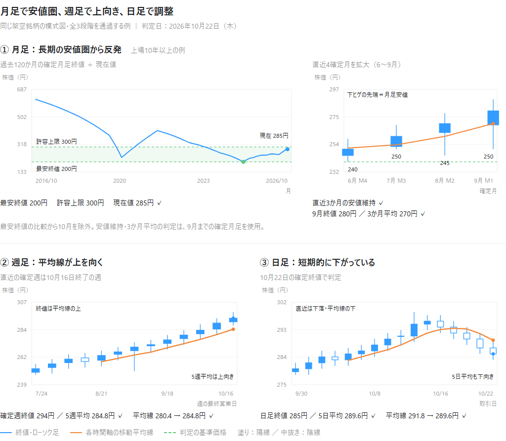

# 日本株・REIT の月足・週足・日足スクリーニング（第1〜第3段階）

第1段階で月足の長期安値圏・安値維持・3か月平均の上抜け、第2段階で確定週足の上向き、第3段階で日足の短期調整を判定します。発注機能はありません。

## 結果の蓄積・通過後の追跡・ローカルLLMによる分析

オプションの `jp_screening.analysis` で、判定時点の条件をPostgreSQLに固定して保存し、候補から外れた後も株価を継続して収集できます。5・20・60・120・250営業日後の騰落率と条件別の関連を比較し、Streamlitから履歴・追跡・資料・更新状況を確認できます。

文章は同じDBのpgvectorで検索します。**回答用LLMと埋め込みモデルはOllamaでPC内に取得して実行**し、数値はSQL／Pythonで計算します。Ollama停止中も結果の取り込みと数値分析を継続できます。J-Quantsからの株価取得にはインターネット接続が必要です。

導入手順、Mac／Windowsの15分間隔の定期実行、障害復旧、バックアップ、計算仕様は [分析機能の使い方](docs/analysis.md) を参照してください。分析用の追加依存を入れない場合も、以下の既存スクリーニングを利用できます。

## チャートのイメージ

同じ架空銘柄が第1〜第3段階の条件をすべて満たす例です。月足の長期安値圏・反発、週足の上向き、日足の短期調整を並べています。実在の銘柄や株価ではありません。

<picture>
  <source media="(prefers-color-scheme: dark)" srcset="docs/images/screening-chart-shapes-dark.png">
  <source media="(prefers-color-scheme: light)" srcset="docs/images/screening-chart-shapes-light.png">
  
</picture>

## 1. 作業フォルダーと動作環境

Python 3.11以上が必要です。WindowsではPowerShell、macOSではターミナル（zsh / bash）を使用します。
作業フォルダーは、実際に保存した場所に置き換えてください。

### Windows（PowerShell）

```powershell
Set-Location -LiteralPath 'C:\path\to\contrarian'
python --version
python -m venv .venv
.\.venv\Scripts\python.exe -m pip install --upgrade pip
.\.venv\Scripts\python.exe -m pip install -r requirements-lock.txt
```

### macOS（ターミナル：zsh / bash）

```sh
cd '/path/to/contrarian'
python3 --version
python3 -m venv .venv
./.venv/bin/python -m pip install --upgrade pip
./.venv/bin/python -m pip install -r requirements-lock.txt
```

macOSでは、最初の環境作成に `python3` を使用します。未導入、または3.11未満の場合は、Python 3.11以上をインストールしてから進めてください。
共有Python環境の古いライブラリを読み込まないよう、`--system-site-packages` は使用しません。
`requirements-lock.txt` は検証した直接・間接依存とビルド用ライブラリのバージョンを固定しています。
`pyproject.toml` にも、セキュリティ修正を含むバージョン以上を使用する条件を指定しています。

ソースから直接実行できるため、このプロジェクト自体のインストールは不要です。
以下の操作例では、OSごとに `.venv` 内のPythonを明示します。仮想環境の有効化（activate）は不要です。WindowsでもPowerShellのスクリプト実行ポリシーを変更する必要はありません。
既に `.venv` がある場合も、上記のpip更新と `requirements-lock.txt` のインストールで依存関係を更新してください。

コード、補助入力、キャッシュ、ログ、結果はすべてこのプロジェクト内に作成します。
データベースは単一プロセスで使用し、同時実行はロックで防止します。

## 2. APIキーの設定（実データを使用する場合）

J-Quantsのダッシュボードの API Keys 画面で、V2用APIキーを発行します。Standardプランが必要です。

- ダッシュボード: <https://jpx-jquants.com/>
- 認証の公式案内: <https://jpx-jquants.com/ja/spec/quickstart>

以降のコマンドを実行するのと同じターミナルで、次を実行します。どちらの方法でも、キーの入力は画面に表示されません。

### Windows（PowerShell）

```powershell
$secureKey = Read-Host 'J-Quants APIキー' -AsSecureString
$env:JQUANTS_API_KEY = [System.Net.NetworkCredential]::new('', $secureKey).Password
Remove-Variable secureKey
```

### macOS（ターミナル：zsh / bash）

```sh
printf 'J-Quants APIキー: '
IFS= read -r -s JQUANTS_API_KEY
printf '\n'
export JQUANTS_API_KEY
```

キーは設定したシェルと、そこから起動するPythonにだけ有効です。PowerShellやmacOSのターミナルのタブ・ウィンドウを閉じた場合、次回は再設定してください。

**Windows（PowerShell）**

```powershell
[bool]$env:JQUANTS_API_KEY
```

**macOS（ターミナル：zsh / bash）**

```sh
if [ -n "${JQUANTS_API_KEY:-}" ]; then
    printf '設定済み\n'
else
    printf '未設定\n'
fi
```

## 3. 上場日CSVの用意

J-Quantsの銘柄一覧に上場日がないため、JPX公式の補助CSVが必要です。

1. <https://clientportal.jpx.co.jp/ClientPortal/s/Issue?language=ja> を開く。
2. 「企業・銘柄」の「全件CSV取得」でCSVを保存する。
3. ダウンロードしたCSVを `inputs` フォルダーへ置く。
4. 次のコマンドで取り込む（ファイル名は実際の名前に置き換える）。

**Windows（PowerShell）**

```powershell
.\.venv\Scripts\python.exe -m jp_screening prepare-listings --listing-file '.\inputs\JPXから取得したCSV.csv'
```

**macOS（ターミナル：zsh / bash）**

```sh
./.venv/bin/python -m jp_screening prepare-listings --listing-file './inputs/JPXから取得したCSV.csv'
```

読み込み可能なコード列名：`Code`、`code`、`コード`、`銘柄コード`、`証券コード`。
上場日列名：`listing_date`、`ListingDate`、`東証上場日`、`東証上場年月日`、`上場日`、`上場年月日`。
UTF-8（BOMあり/なし）とCP932に対応します。日付は西暦の `YYYY-MM-DD`、`YYYY/MM/DD`、`YYYYMMDD`、`YYYY年M月D日` に対応します。

列名が異なる場合は、公式CSVの必要な列を次の形式に整理して保存してください。

```csv
Code,listing_date
```

上場日には実際の東証上場日を使用します。最初に取得できた株価の日付や設立年月日ではありません。
前身会社や別コードの履歴は接続しません。空欄の上場日は推定せず「判定不能」にします。
取り込み後の `inputs/listing_dates.csv` と `inputs/listing_dates.source.json` に取得元・日時・ハッシュが保存されます。

直接参照可能な公式CSVリンクがある場合は自動取得も試せます。

**Windows（PowerShell）**

```powershell
.\.venv\Scripts\python.exe -m jp_screening prepare-listings
# 公式CSVの直接リンクを把握している場合
.\.venv\Scripts\python.exe -m jp_screening prepare-listings --listing-url 'https://JPX公式サイトのCSVリンク'
```

**macOS（ターミナル：zsh / bash）**

```sh
./.venv/bin/python -m jp_screening prepare-listings
# 公式CSVの直接リンクを把握している場合
./.venv/bin/python -m jp_screening prepare-listings --listing-url 'https://JPX公式サイトのCSVリンク'
```

JPXポータルはJavaScriptで動作するため、直接CSVリンクを発見できない場合は手動取得の案内を表示します。
非公開APIへの依存や、上場日の推定による代用はしません。

## 4. 実行

### まず少数銘柄の検証

各営業日の引け後、日足データ公開後に実行します。

**Windows（PowerShell）**

```powershell
.\.venv\Scripts\python.exe -m jp_screening sample
```

**macOS（ターミナル：zsh / bash）**

```sh
./.venv/bin/python -m jp_screening sample
```

株式・REIT、上場8～10年・10年以上、調整係数の変更履歴を含むよう、原則10銘柄を選びます。
該当区分がない場合は取得可能な他の対象銘柄で補います。コード順で選び、選定一覧も保存します。
実際の月足計算は銘柄指定APIの調整済み株価を使い、一括ファイルから計算した株価とも全日付のOHLCを照合します。

指定銘柄で検証する場合：

**Windows（PowerShell）**

```powershell
.\.venv\Scripts\python.exe -m jp_screening sample --codes 7203 6758 8951
```

**macOS（ターミナル：zsh / bash）**

```sh
./.venv/bin/python -m jp_screening sample --codes 7203 6758 8951
```

### 全銘柄の第1段階判定

**Windows（PowerShell）**

```powershell
.\.venv\Scripts\python.exe -m jp_screening all
```

**macOS（ターミナル：zsh / bash）**

```sh
./.venv/bin/python -m jp_screening all
```

全銘柄実行時も、先に少数照合を実行します。不一致があれば全銘柄判定へ進みません。
初回は過去10年分の全銘柄一括データを取得するため、少数検証でもダウンロード量は小さくありません。
取得済みファイルはキャッシュします。中断した場合は同じコマンドで再開できます。

絞った範囲で同じ処理を試す場合：

**Windows（PowerShell）**

```powershell
.\.venv\Scripts\python.exe -m jp_screening all --codes 7203,6758,8951
```

**macOS（ターミナル：zsh / bash）**

```sh
./.venv/bin/python -m jp_screening all --codes 7203,6758,8951
```

### 第2段階：週足条件も適用する

最新データで第1段階から第2段階まで判定する場合：

**Windows（PowerShell）**

```powershell
.\.venv\Scripts\python.exe -m jp_screening sample --stage 2
.\.venv\Scripts\python.exe -m jp_screening all --stage 2
```

**macOS（ターミナル：zsh / bash）**

```sh
./.venv/bin/python -m jp_screening sample --stage 2
./.venv/bin/python -m jp_screening all --stage 2
```

各実行で月足条件を再判定し、その時点で第1段階を通過した銘柄だけを週足で評価します。
`--stage` を省略した従来の `sample` / `all` は、第1段階のみ実行します。

保存済みデータと同じ判定日で、週足条件を検証する場合は次を使用します。APIキーや再取得は不要です。

**Windows（PowerShell）**

```powershell
.\.venv\Scripts\python.exe -m jp_screening weekly --run-id '20261022_220242_110790_recompute'
```

**macOS（ターミナル：zsh / bash）**

```sh
./.venv/bin/python -m jp_screening weekly --run-id '20261022_220242_110790_recompute'
```

このコマンドも、保存済みの日足から第1段階を再計算してから週足条件を適用します。
現在日の判定ではなく、指定した保存データの判定日での結果になります。
`recompute --run-id 実行ID --stage 2` でも同じ処理を実行できます。

### 第3段階：日足条件も適用する

最新データで第1段階から第3段階まで再判定する場合：

**Windows（PowerShell）**

```powershell
.\.venv\Scripts\python.exe -m jp_screening sample --stage 3
.\.venv\Scripts\python.exe -m jp_screening all --stage 3
```

**macOS（ターミナル：zsh / bash）**

```sh
./.venv/bin/python -m jp_screening sample --stage 3
./.venv/bin/python -m jp_screening all --stage 3
```

保存済みの株価を使い、同じ判定日で第3段階まで検証する場合（APIキー不要）：

**Windows（PowerShell）**

```powershell
.\.venv\Scripts\python.exe -m jp_screening daily --run-id '20261022_224307_516449_stage2'
```

**macOS（ターミナル：zsh / bash）**

```sh
./.venv/bin/python -m jp_screening daily --run-id '20261022_224307_516449_stage2'
```

`recompute --run-id 実行ID --stage 3` でも同じ処理を実行できます。
保存された候補の合否をそのまま流用せず、全銘柄の月足と週足を再計算し、週足まで通過した銘柄だけを日足で判定します。
この例の判定日は2026年10月22日です。現在日の判定には `all --stage 3` を使用します。

APIキー未設定・認証失敗・更新待ちは終了コード2です。取引時間中の実行は受け付けません。
日足の更新は通常16:30頃ですが、時刻だけで公開済みとは判断せず、当日のAPI応答を確認します。
休業日は直前営業日を判定します。公開されていない日付を、黙って古い日付に置き換えません。

## 5. 出力の確認

`outputs/実行ID/` に保存します。CSVはUTF-8 BOM付きです。

- `candidates.csv`：第1段階をすべて通過した銘柄。
- `all_results.csv`：条件別の合否・使用値・理由を含む全件結果。
- `monthly_audit.csv`：月足終値・月足安値・月末営業日・取得漏れ日数・終値採用日・月末との差（営業日）・採用方法。
- `validation_codes.csv`：少数照合に使った銘柄。
- `validation.json`：APIと一括データの価格照合、別計算での条件照合。
- `spot_checks.json`：全件判定後、通過・不通過から最大各5件の別計算照合。
- `run.json`：判定日、件数、設定、取得元、入力ハッシュ、再計算用スナップショットの参照。
- `error.json`：処理が途中で終了した場合の理由。この場合は正常完了ではありません。

第2段階まで実行した場合は、以下を追加します。

- `candidates.csv`：第1段階・第2段階の両方を通過した最終候補。
- `stage1_candidates.csv`：第1段階を通過した銘柄。週足の判定結果も併記。
- `weekly_results.csv`：第1段階通過銘柄の週足条件別の合否・使用値。
- `weekly_audit.csv`：直近6確定週の終値・高値・安値・終値採用日・取得漏れ日数。
- `all_results.csv`：元の月足列に、第1・第2段階の判定、週足条件、5週平均と前週5週平均などを追加。

第3段階まで実行した場合は、以下も追加します。

- `candidates.csv`：第1〜第3段階をすべて通過した最終候補。
- `stage2_candidates.csv`：週足まで通過した銘柄。日足の判定結果も併記。
- `daily_results.csv`：週足通過銘柄の日足条件別の合否・終値・当日と前営業日の5日平均。
- `daily_audit.csv`：判定に使用した直近6営業日の日付・調整済み終値・レコード有無。
- `all_results.csv`：全銘柄の結果に、第3段階の判定と日足条件の列を追加。

「判定」は指定した段階までの総合結果です。第1段階を通過していない銘柄の週足判定、および第2段階を通過していない銘柄の日足判定は「未対象」です。
`stage1_pass` / `stage2_total` は月足通過数、`stage2_pass` / `stage3_total` は週足通過数、`stage3_pass` は3段階すべての通過数です。

銘柄単位で「判定不能」があることと、実行全体が失敗したことは区別します。
上場8年未満は「対象外」、データ不足や上場日不明は「判定不能」、条件違反は「不通過」です。
候補0件でも、照合と処理が正常終了していれば正常な結果です。

銘柄コードは文字列です。Excelで先頭ゼロを保つ場合は「データ→テキスト/CSVから」でコード列を文字列に指定してください。
結果CSVの価格・比率は計算精度を保って出力するため、表示上の小数桁数は一定ではありません。
すべてのCSV出力で、数式として扱われ得る文字列の先頭にアポストロフィを付けます。
`=`・`+`・`-`・`@`、全角の同等文字、先頭の空白や制御文字を考慮し、照合用の銘柄一覧にも同じ保護を適用します。
数値型の価格・上昇率はこの文字列変換の対象外です。CSVを表計算ソフトで再保存すると文字列保護の扱いが変わる場合があるため、再取込時も銘柄名などは文字列として指定してください。

## 6. 再現性とAPI不要の動作確認

実行時の入力は `data/snapshots/実行ID.jsonl.gz` に保存します。データベースの更新後も、同じ入力から再計算できます。
スナップショットのハッシュと計算結果のハッシュが一致しなければエラーにします。

**Windows（PowerShell）**

```powershell
.\.venv\Scripts\python.exe -m jp_screening replay --run-id 'outputs内の実行ID'
```

**macOS（ターミナル：zsh / bash）**

```sh
./.venv/bin/python -m jp_screening replay --run-id 'outputs内の実行ID'
```

`replay` は保存時の月足終値ルールと週足条件を使い、元の合否を再現します。
週足の旧形式（高値突破を含む3条件）も、保存時の3条件で再現します。
`weekly` / `recompute` は現在の週足2条件を使用します。
ルールの記録がない旧形式は、旧ルール「月末営業日の終値のみ」として再現します。

保存した同じ株価を、新しい月足終値ルールで判定し直す場合は次を使用します。APIキーは不要です。

**Windows（PowerShell）**

```powershell
.\.venv\Scripts\python.exe -m jp_screening recompute --run-id 'outputs内の実行ID'
```

**macOS（ターミナル：zsh / bash）**

```sh
./.venv/bin/python -m jp_screening recompute --run-id 'outputs内の実行ID'
```

実行段階に応じて `_recompute`・`_stage2`・`_stage3` 付きの新しい結果フォルダーを作成します。元の結果は上書きしません。
`change_summary.json` に変更前後の件数と合否の変化を保存します。
新しい結果も、同じ実行IDを指定する `replay` で再現できます。

APIキーがなくても、合成データでCSV出力・判定・再計算を試せます。

**Windows（PowerShell）**

```powershell
.\.venv\Scripts\python.exe -m jp_screening demo
```

**macOS（ターミナル：zsh / bash）**

```sh
./.venv/bin/python -m jp_screening demo
```

`_DEMO` 付きのフォルダーに、通過・上限超過・安値割れ・終値欠損の4件を作成します。
**DEMOは実際の銘柄・株価・JPX営業日ではありません。実データ検証の代わりにはなりません。**

自動テスト：

**Windows（PowerShell）**

```powershell
.\.venv\Scripts\python.exe -m unittest discover -s tests -v
```

**macOS（ターミナル：zsh / bash）**

```sh
./.venv/bin/python -m unittest discover -s tests -v
```

## 7. 判定仕様

### A. 長期の月足最安終値からの許容幅

- 上場10年以上：当月を除く直前120か月の月足終値。
- 上場8年以上10年未満：上場月から前月までの月足終値。
- 上場8年未満：対象外。
- 必要な比較月の終値が欠けていれば、比較期間を短縮せず判定不能。
- 最古月も、取得範囲内の月内最終取引日の終値があり、その後の月末までのレコードを確認できれば使用可。月初が契約範囲外でも、それだけで終値を無効にしない。
- 月末の判定でも、比較期間に当月は含めない。

最安終値 `L`、直近営業日の調整済み終値 `C` に対して：

```text
許容上限 = L + MIN(MAX(L × 0.2, 100円), L × 0.5)
条件A = C ≦ 許容上限
```

上場8年以上の株式・REITで共通です。最安終値割れも条件A単独では通過します。
100円は判定時点の1株または1口当たりの価格基準です。将来のリターンを予測する係数ではありません。

### B. 直近3確定月の安値維持

最新の確定月から M1、M2、M3、M4 として：

```text
MIN(M1安値, M2安値, M3安値) ≧ M4安値
```

### C. 3か月移動平均の上抜け

```text
M1終値 ＞ (M1終値 + M2終値 + M3終値) ÷ 3
```

厳密な比較には `M1終値 × 3 ＞ 3か月の終値合計` を使い、循環小数の丸めで同値判定が変わらないようにします。
月末最終営業日のデータ公開後は当月がM1、それ以外は前月がM1です。

### 欠損・価格調整

- 0円化、前日値の補完、欠けた月を飛ばして古い月で本数を埋める処理はしません。
- 月足終値には、その月の最後の実取引日の調整済み終値を使用します。
- 月末営業日に取引がない場合は、同じ月内だけをさかのぼります。採用日から月末までのレコードが存在し、OHLCがすべて欠損（無約定）であることを確認します。
- レコードの取得漏れ、または高値・安値などは存在するのに終値だけが欠損する不整合があれば、さかのぼりを止めて欠損とします。
- 1か月全体に終値がない場合は判定不能です。前月の価格は持ち越しません。
- 終値を採用した日と月末との差は `monthly_audit.csv` で確認できます。
- 直近営業日の終値はこれまでどおり当日の値を必要とし、前営業日の終値で代用しません。
- 無約定日としてレコードが存在するNullと、取得漏れでレコード自体がない場合を区別します。
- 月足安値には有効な日足安値を使います。必要期間のレコード欠落が未解決なら安値を確定しません。
- APIは調整済み価格を小数1桁で提供します。一括データも公式の同じ丸め規則で入力価格を再現し、それ以降の判定では追加の丸めをしません。
- 価格計算はDecimalを使います。調整係数の累積には60桁精度を使用します。
- 現金配当はJ-Quantsの株価調整対象ではありません。

## 8. 第2段階：週足の判定仕様

月曜日から金曜日を1週間とし、取引カレンダーの現物市場の営業日を使用します。
金曜日が祝日なら木曜日など、その週の最終営業日をもって確定します。
祝日でも先物だけ取引される日は、現物株の営業日に含めません。

例えば2026年10月22日（木）の保存データでは、10月19日からの週は未確定です。
最新の確定週は10月12日〜16日の週となります。

最新の確定週をW1、1週前をW2、順にW6まで使用します。
第1段階を通過した銘柄について、以下のすべてを満たすことを条件とします。

```text
条件1：W1終値 ＞ (W1〜W5の終値の合計) ÷ 5
条件2：(W1〜W5の終値の合計) ÷ 5 ＞ (W2〜W6の終値の合計) ÷ 5
```

- 比較はすべて厳密な「＞」です。同値は通過しません。
- 高値突破の条件は使用しません。週足高値が欠損していても、必要な終値がそろえば週足の2条件を判定できます。
- 週足高値・安値は監査用のCSVに残しますが、週足の合否には使用しません。
- 月足と同じ調整基準の日足価格を使用します。
- 週足終値は、その週の最後の実取引日の終値です。週末に無約定が続く場合も同じ週内だけを使用し、採用日をCSVに記録します。
- 銘柄の1週間全体に取引がなければ欠損の週足として扱い、古い週で本数を埋めません。
- 市場全体が1週間休場の場合、その週には週足が存在しないため取引週に含めません。
- 期間内の営業日レコードが取得漏れなら、その週足は判定用データ不足とします。
- 条件ごとに必要データを確認し、計算できない条件は判定不能とします。
- `replay` は保存時の段階と週足条件で再現します。旧形式の3条件の結果も維持します。
- 現在の2条件で再判定する場合は `weekly --run-id 実行ID` または `recompute --run-id 実行ID --stage 2` を使用します。

公式仕様：

- <https://jpx-jquants.com/ja/spec/eq-bars-daily>
- <https://jpx-jquants.com/ja/spec/eq-bars-daily/adj>
- <https://jpx-jquants.com/ja/spec/data-spec>
- <https://jpx-jquants.com/ja/spec/rate-limits>
- <https://jpx-jquants.com/ja/spec/mkt-cal>

## 9. 第3段階：日足の判定仕様

第1段階・第2段階を通過した銘柄について、以下の2条件をすべて満たすことを条件とします。
判定日をD1、前営業日をD2、順にD6まで、現物市場の取引カレンダーに従って選びます。

```text
条件1：D1終値 ＜ (D1〜D5の終値の合計) ÷ 5
条件2：(D1〜D5の終値の合計) ÷ 5 ＜ (D2〜D6の終値の合計) ÷ 5
```

- 取引終了後に公開済みの確定日足だけを使用します。進行中の日足は使用しません。
- 月足・週足と同じ調整基準の終値を使用します。
- 比較はすべて厳密な「＜」です。同値は通過しません。
- 土日・休場日・先物だけの祝日取引日は、営業日の本数に含めません。
- 各営業日の終値をそのまま使用します。無約定日・取得漏れ・終値欠損を古い営業日の値で補いません。
- 直近5営業日の終値が不足する場合は条件1・2とも判定不能、D6のみ不足する場合は条件1を評価し条件2を判定不能とします。
- 日足判定は条件別に行い、必要な条件が計算できなければ第3段階は判定不能です。
- `stage3_unknown` は週足通過銘柄のうち日足で判定できなかった数です。それ以前の段階の判定不能は総合の「判定不能」に残ります。
- `replay --run-id 実行ID` で保存時の全段階の結果を再現できます。`weekly` または `recompute --stage 2` を使えば、同じデータで第2段階までに戻して再判定できます。
- 公開前には、実際にコミットする一覧にもAPIキー・実データ・個人環境のファイルがないことを確認してください。
- 固定バージョンは2026年10月23日の検証時点のものです。更新時には脆弱性情報とテストを再確認してください。

